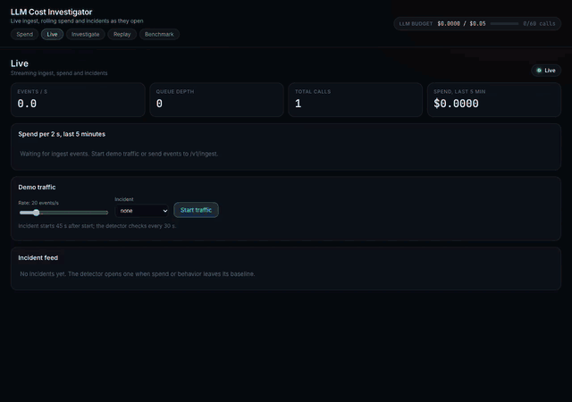
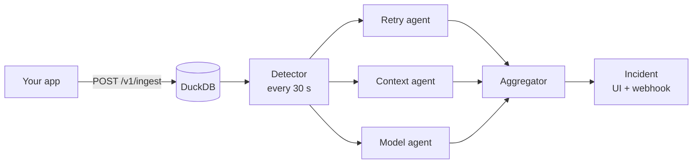

<div align="center">

# 🐕 Tokenhound

### Your LLM bill just doubled. Tokenhound tells you why.

It watches every LLM call your app makes, catches a cost spike in minutes,
and names the bug behind it.

[](https://github.com/prathameshk421/LLM_Cost_Investigator/actions/workflows/ci.yml)

[](LICENSE)


[](docs/proof/media/tier_d_take5_timelapse.mp4)

<sub>2 h 15 min of a live app with real LLM calls, in 54 s. Two real bugs go in. Both are named within 4 minutes.
<a href="docs/proof/media/tier_d_take5_timelapse.mp4">Watch with sound</a></sub>

</div>

---

## The problem

LLM bills do not grow slowly. They jump.

- A JSON validator fails, and the client retries **15 times per request**.
- A config change sends a feature to a model that costs **6x more**.
- An agent calls itself and resends its **whole history** on every turn.

Each of these can burn money for hours. A budget alert fires late, if it fires
at all. A cost dashboard shows *that* spend went up. It does not show *why*.

## What Tokenhound does

It catches the spike, then finds the cause, and shows its evidence.

| Bug | What Tokenhound sees | Live time to detect |
|---|---|---|
| 🔁 **Retry loop with no cap** | `retry_count` climbs, one parent call fans out into many children | **58 s** |
| 💸 **Switch to a pricier model** | Cost per token jumps on a feature while tokens stay flat | **3 min 58 s** |
| 🌀 **Self-calling agent** | Parent chains get deeper than the feature ever had, and prompts grow | **59 s** |
| 📈 **Just more traffic** | Volume grows, cost per call does not. Shown in analytics, **not** raised as an incident | n/a |

The times come from a [live run with real API calls](docs/proof/tier_d.md), not a simulation.

## Proof, not vibes

Every threshold was **committed before the run** ([pre-registration](benchmarks/PREREGISTRATION.md)).
Every run is published, including the ones that failed.

| Test | Result |
|---|---|
| **2,800 blind synthetic datasets** (generator written without seeing the rules) | **99.1%** of incidents caught, **0.5%** false alarms |
| Same data, three hand-written rules | 100% caught, but **16.4%** false alarms (33x more) |
| **Real Azure OpenAI traffic** (BurstGPT trace, 1.4M requests) with injected bugs | **96.5%** caught, **0** false incidents in 171 feature-weeks |
| **Red team**: 12 adversarial cases × 20 seeds | **0** crashes, **0%** confident wrong answers |
| **Live app**, real API calls, three real bugs | each one named in **1 to 4 min**, **0** alarms in 150 min of clean baseline |
| Optional LLM agents (DeepSeek V4.1 Flash) vs deterministic | same accuracy (McNemar p = 1.0), **$0.002** per investigation |

Full results with intervals, raw data and failure analysis: [docs/proof/results.md](docs/proof/results.md).

## Try it in 60 seconds

No API key needed. The default agents are deterministic.

```bash
git clone https://github.com/prathameshk421/LLM_Cost_Investigator.git tokenhound
cd tokenhound
docker compose up --build
```

Open **http://localhost:8000**. Then load 60 days of demo traffic with real-looking incidents:

```bash
make demo-seed
```

No Docker? Use `make install && make serve`.
Or open the **Live** tab and press **Start traffic** to watch an incident open in real time.

## Plug it into your app

Copy one file, [`examples/live_app/llmci_wrapper.py`](examples/live_app/llmci_wrapper.py) (about 90 lines, standard library only).
It reports token usage from a background thread. If Tokenhound is down, your app does not notice.

```python
from openai import OpenAI
from llmci_wrapper import instrument, llmci_context

client = instrument(OpenAI(), "http://localhost:8000")

with llmci_context(feature_tag="summarize"):
    client.chat.completions.create(model="gpt-4o-mini", messages=[...])
```

Other ways in:
- `POST /v1/ingest` with canonical or **OpenTelemetry GenAI** events
- Pull traces from **Langfuse**
- Upload **JSONL, CSV** or OpenAI-style logs
- An optional **Kafka / Redpanda** bridge: `docker compose --profile kafka up`

## How it works



- **Detector:** z-scores per feature against a rolling 6-hour baseline, plus history-aware rules, so normal growth stays quiet.
- **Agents:** each agent has one job and a set of **hard skills**: Python checks that pass, fail or falsify a hypothesis. Every number is computed in code before any LLM sees it.
- **LLM optional:** an LLM can write the explanation. It cannot override the evidence. If it disagrees with the hard skills, the finding stays, at lower confidence, and is marked for review.
- **Budget-guarded:** live LLM calls have a daily cap, a token cap and a hard deadline, so the cost tool cannot become the cost problem.

## What you get

- **Live**: streaming ingest, spend per feature, and incidents as they open
- **Spend**: month-end forecast with a P10 to P90 band, budgets, cost drivers split into volume, tokens per call and price, a model what-if, and retry and chain waste
- **Investigate**: run on a file, a Langfuse pull or a simulated scenario, and see the verdict with a timeline
- **Replay**: step through recorded investigations, agent by agent
- **Benchmark**: accuracy per cause, false-alarm rate, confusion matrix
- Slack-compatible webhook alerts, bearer-token auth, Docker, and CI with a held-out accuracy gate

## Honest limits

- **Not the fastest alarm.** On synthetic data the median time to confirm is 11 to 22 min. Three simple rules fire sooner but raise 33x more false alarms.
- **Needs about 1 hour of history** for a feature before it gives a verdict.
- **Not proven on customer data yet.** All incidents in the proof are injected or induced.
- **Prices come from a static table**, so costs are estimates, not invoice-exact.
- **It cannot tell a planned upgrade to a pricier model from a mistake.** Both look the same in telemetry.

## Roadmap

- [ ] Per-user and per-session spend concentration (catch one client or bot draining a feature)
- [ ] A case study on a real team's traces
- [ ] LiteLLM callback, so no wrapper is needed
- [ ] Live price sync instead of the static table

Have a cost incident story, or traces you can share? Open an issue. Real data is the most useful contribution.

## Docs

| | |
|---|---|
| [docs/GUIDE.md](docs/GUIDE.md) | Setup, CLI, connectors, API endpoints, budget guard, logs |
| [docs/ARCHITECTURE.md](docs/ARCHITECTURE.md) | Design decisions and the HTTP contract |
| [docs/proof/](docs/proof/results.md) | Pre-registered results, raw data, videos |
| [AGENTS.md](AGENTS.md) | Agent prompts, hard skills and the aggregator contract |

## License

[MIT](LICENSE). Use it, fork it, ship it.

<sub>Repository and Python package names: `LLM_Cost_Investigator`, `llm_cost_investigator`.</sub>
