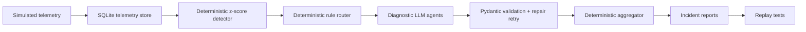

# LLM Cost Investigator

Agentic LLM cost anomaly investigator for diagnosing sudden spend spikes in LLM-backed features.

## Results

**Read the held-out row first.** The scenario lab was used while the rules were
tuned, so its numbers are in-sample. The held-out set comes from a generator
written blind to the rules (`benchmarks/heldout/SPEC.md`), and the reported
seeds were never used for tuning.

| Evaluation | Datasets | Incidents caught | False alarm rate | Notes |
|---|---|---|---|---|
| **Held-out, fresh seeds 90-119** | 840 (28 cases) | **99.6%** | **0 / 300 negatives** | precision ≥ 0.99 per root cause, about 12 incident groups per dataset |
| Held-out, fresh seeds 30-59 (before the volume gate) | 840 | 99.4% | 0 / 300 | about 200 flagged groups per dataset |
| Held-out, test half (scored once) | 420 | 99.6% | 2.0% | before the cheaper-model falsifier |
| Held-out, same code before the fixes | 840 | 66% | 85% | the overfit baseline |
| 60-day history, live-tick scan | 3,585 slices × 5 histories | 15 / 15 incidents | 0 false reports | trailing 6 h every 2 h |
| Scenario lab (in-sample) | 300 per noise level | 100% | 0% | 8% to 35% noise |
| Live LLM agents (HF `gpt-oss-20b`) | 20 | 100% | 0% | $0.0041 for 16 calls |

Held-out cases include hard negatives (traffic surge, marketing burst, switch to
a cheaper model, A/B ratio shift, +40% prompts, normal RAG chains, clock gaps)
and subtle positives (2x misroute at night, depth-4 chains, small retry storms).
Run it with `make heldout`. CI runs a 4-seed held-out gate on every push.

Known limits: the detector needs 1 hour of history for a feature before it
gives a verdict. Pure traffic growth is shown in spend analytics, not raised as
an incident. A live LLM can disagree with the hard skills; the finding is then
kept at reduced confidence and flagged for review (see `docs/ARCHITECTURE.md`).

## Why LLM Cost Anomalies Matter

Uncontrolled cost growth in LLM applications can occur rapidly due to software defects, recursive loops, or misconfigurations. Detecting cost spikes deterministically is easy, but identifying *why* they happened requires deep semantic analysis of the underlying API telemetry (e.g., distinguishing between a model upgrade, an infinite retry storm, or expanding prompts). This investigator automates diagnostics using specialized agent roles.

## Architecture

The control plane uses a deterministic detection and routing pipeline to coordinate diagnostic LLM agents:



Presentation layer (optional):

```text
data/reports + data/replay  -->  web/api (FastAPI)  -->  web/frontend (React replay UI)
```

## Product architecture (v2)

See [docs/ARCHITECTURE.md](docs/ARCHITECTURE.md) for the decisions and the HTTP contract.

- **Ingest:** `POST /v1/ingest` (canonical or OpenTelemetry GenAI-style events) into a bounded queue
  and a batch writer. An optional Kafka/Redpanda bridge (`docker compose --profile kafka up`) posts into the same endpoint.
- **Storage:** DuckDB warehouse (`data/warehouse.duckdb`), 65x to 260x faster than SQLite on the spend rollups at 1M calls.
- **Live detection:** a deterministic tick every 30 s over the trailing 6 h opens incidents.
  LLM agents run only when a user clicks *Diagnose with LLM* (budget-guarded).
- **Spend analytics:** KPIs, month-end forecast with a P10-P90 band, budgets and alerts,
  cost drivers split into volume / tokens-per-call / price effects, model what-if, retry and chain waste.
- **UI tabs:** Spend · Live · Investigate · Replay · Benchmark. **Run:** `make dev` or `docker compose up`.

## Repository layout

```text
llm_cost_investigator/   # core pipeline package + CLI
tests/                   # automated tests
web/
  api/                   # FastAPI read-only replay API
  frontend/              # React investigation replay UI
data/
  reports/incidents/     # generated incident JSON/MD
  reports/transcripts/   # live tool-use captures
  replay/                # normalized UI fixtures
scripts/
  live/                  # live provider harnesses
  export_replay_catalog.py
  dev_replay.sh
docs/plans/              # design / build plans
```

## Deterministic Detector/Router

- **Detector**: Computes z-scores on telemetry (cost, tokens, retries, latency) relative to baseline metrics.
- **Router**: Uses deterministic routing rules based on z-score signals to route the anomaly to the correct diagnostic agent (e.g. routing to the model routing agent when a model change is detected).

## Diagnostic Agents and Fallback Mode

Diagnostic agents (`retry_loop_agent`, `token_context_agent`, `model_routing_agent`) are restricted to narrow telemetry slices, keeping prompt tokens small and highly focused. Responses are validated using Pydantic schemas.

If validation fails, a repair retry is executed. When API keys are absent, or live calls fail twice, the system falls back to a deterministic fallback module to safely complete execution.

## Setup

Install core package:

```bash
pip install -e .
```

Install core + web (replay API):

```bash
pip install -e ".[web]"
```

Optional API keys for live LLM diagnostic agents:

```bash
export GROQ_API_KEY=your_key_here    # Groq provider
export CEREBRAS_API_KEY=your_key     # Cerebras provider
export HF_TOKEN=hf_your_token        # Hugging Face Inference Providers
export LLM_MODEL=openai/gpt-oss-120b  # optional model override
```

The `hf` provider uses the Hugging Face router (`router.huggingface.co/v1`,
OpenAI-compatible, default model `openai/gpt-oss-20b`). If `HF_TOKEN` is not
set, it reads the token from `hf auth login`. A cached login is only used when
you pass `--provider hf`, so a run never spends credits by surprise.

### Budget guard

Every live call goes through a budget guard (`llm_cost_investigator/usage.py`).
When a limit is reached, the agents use the deterministic path. The run still
finishes, it only stops spending.

| Variable | Default | Meaning |
|---|---|---|
| `LLM_BUDGET_USD` | `0.05` | Max estimated spend per process |
| `LLM_MAX_CALLS` | `60` | Max live calls per process |
| `LLM_CALL_LOG` | `data/logs/llm_calls.jsonl` | One JSON line per live call |

Or copy `.env.example` to `.env` in the project root (keys are loaded automatically):

```text
GROQ_API_KEY=gsk_your_key_here
CEREBRAS_API_KEY=your_key_here
```

Without API keys the system automatically uses deterministic fallback mode.

## Run Commands

Preferred CLI:

```bash
python -m llm_cost_investigator.cli --scenario retry_loop
python -m llm_cost_investigator.cli --scenario context_bloat
python -m llm_cost_investigator.cli --scenario model_misroute
# or after install:
llm-cost-investigator --scenario all --force-fallback
```

Compatibility shim (same as above):

```bash
python3 main.py --scenario all
```

Live LLM diagnosis (when an API key is configured):

```bash
python -m llm_cost_investigator.cli --scenario model_misroute --provider groq
```

Run tests (see [Testing](#testing)):

```bash
python -m pytest -q
```

## Investigate real / external telemetry

Ingest adapters normalize external logs into `LLMCall`, then run the same detector → agents → report pipeline.

| Adapter | Input |
| --- | --- |
| `jsonl` | Canonical one-object-per-line (or JSON array). See `docs/ingest/CANONICAL_JSONL.md` |
| `openai` | Chat Completions-style dumps (`usage.prompt_tokens`, `id`, `created`, …) |
| `csv` | Header row + `--map logical=column` pairs |
| `auto` | Sniff format from extension/content |

Missing `cost_usd` is estimated from a small pricing table. Missing `parent_call_id` / `retry_count` / `latency_ms` default safely.

```bash
# Generate samples from the simulator
python3 scripts/export_sample_telemetry.py

python -m llm_cost_investigator.cli investigate \
  --input data/samples/canonical_sample.jsonl \
  --adapter jsonl \
  --force-fallback

python -m llm_cost_investigator.cli investigate \
  --input data/samples/openai_style_sample.json \
  --adapter openai \
  --force-fallback

python -m llm_cost_investigator.cli investigate \
  --input data/samples/csv_sample.csv \
  --adapter csv \
  --map timestamp=ts,call_id=id,feature_tag=feature,model=model,input_tokens=prompt_tokens,output_tokens=completion_tokens,cost_usd=cost,latency_ms=latency,retry_count=retries,parent_call_id=parent_id \
  --force-fallback
```

### Frontend (Investigate mode)

Same dev stack as replay. Open the UI on the **Investigate** tab, then pick a source:

- **Simulate**: one-click lab scenario with a seed and noise level (no file needed)
- **File upload**: sample JSONL/CSV/OpenAI-style file (use **Fallback** for offline)
- **Remote (Langfuse)**: pull last N hours using env keys (no keys in the browser)

API endpoints:

- `POST /api/investigate/preview`: ingest only  
- `POST /api/investigate`: ingest + diagnose  
- `GET /api/investigate/pricing`: known model rates  
- `GET /api/connectors`: registered remote connectors  
- `GET /api/connectors/profiles`: named connection profiles  
- `POST /api/connectors/test|preview|investigate`: Langfuse pull path
- `POST /api/simulate`: make a lab dataset and diagnose it (`scenario`, `seed`, `noise`, `provider`)
- `GET /api/usage`: live LLM spend, limits, provider status, recent calls
- `GET /api/benchmark`: accuracy benchmark (deterministic agents, no spend)  

### Pull from Langfuse

Set `LANGFUSE_PUBLIC_KEY` and `LANGFUSE_SECRET_KEY` in `.env` (optional `LANGFUSE_HOST`). See `docs/connectors/LANGFUSE.md`.

```bash
python -m llm_cost_investigator.cli investigate \
  --connector langfuse \
  --since-hours 24 \
  --force-fallback

# optional named profile: copy docs/connectors/connections.example.yaml → .llmci/connections.yaml
python -m llm_cost_investigator.cli investigate --connection prod-langfuse --force-fallback
```

## Investigation replay UI

Build fixtures from reports/transcripts, then start API + UI:

```bash
python3 scripts/export_replay_catalog.py

# terminal 1
PYTHONPATH=web:. uvicorn api.app:app --reload --port 8000

# terminal 2
cd web/frontend && npm install && npm run dev
```

Or one script:

```bash
./scripts/dev_replay.sh
```

- API: http://127.0.0.1:8000  
- UI: http://localhost:5173  

The UI has three tabs:

- **Investigate** (default): run a lab scenario in one click (deterministic or
  live LLM agents), upload your own telemetry, or pull from Langfuse. Results
  show a correct/wrong verdict, a cost timeline with the flagged windows, and
  the stage-by-stage replay of the agents.
- **Replay**: recorded investigations, including live tool-use transcripts.
- **Benchmark**: accuracy per scenario, false alarm rate and a confusion matrix.

## Testing

| What | Command | Needs |
|---|---|---|
| Unit, replay, API tests (73) | `python -m pytest -q` | nothing |
| Three demo scenarios | `python -m llm_cost_investigator.cli --scenario all --force-fallback` | nothing |
| Accuracy benchmark | `python -m llm_cost_investigator.benchmark --seeds 30 --noise 0.15` | nothing |
| CI accuracy gate | add `--min-accuracy 0.97` (exit 1 below it) | nothing |
| Live LLM benchmark | `python -m llm_cost_investigator.benchmark --seeds 3 --provider hf` | `HF_TOKEN` or `hf auth login` |
| UI end to end | start API + UI, open **Investigate → Simulate → Run** | nothing |

`.github/workflows/ci.yml` runs pytest, the scenario CLI, the accuracy gate and
the frontend build on every push.

### Scenario lab

`llm_cost_investigator/scenario_lab.py` makes a new noisy dataset per seed:
random start time, jittered baseline, random incident size, and distractor
features. Scenarios: `retry_loop`, `context_bloat`, `model_misroute`, plus the
controls `traffic_surge` (real demand, no bug) and `clean`.

## Logs and observability

| Where | What |
|---|---|
| `data/logs/llm_calls.jsonl` | Every live LLM call: model, tokens, latency, est. USD, tool calls, errors |
| `GET /api/usage` | Live spend, limits, provider status and the last 50 calls |
| UI header **LLM budget** badge | Same data; click it for the recent call table |
| `data/reports/incidents/*.md/json` | One report per investigated incident |
| `data/reports/benchmark.json` | Last CLI benchmark run, with every failed case |
| API stdout | uvicorn access log + one line per `/api/simulate` run |

## Sample `--force-fallback` Output

```text
Fallback used: model_routing_agent (fallback provider explicitly selected)

Scenario:         model_misroute
Detected anomaly: summarizer model change (gpt-4o-mini → gpt-4.1)
Routed agents:    model_routing_agent
Root cause:       expensive_model_misroute
Confidence:       0.95
Report:           data/reports/incidents/model_misroute_incident.md
Result:           PASS
```

## Scenario Matrix

| Scenario | Root Cause | Routed Agent | Signal Pattern |
|---|---|---|---|
| `retry_loop` | `uncapped_retry_loop` | `retry_loop_agent` | High retry count, repeated parent calls, latency growth |
| `context_bloat` | `context_bloat_self_calling_agent` | `token_context_agent` | Expanding input tokens, deep call chain |
| `model_misroute` | `expensive_model_misroute` | `model_routing_agent` | Model switched to pricier model, stable token count |

## Reports

Each run writes structured incidents under:

- `data/reports/incidents/<scenario>_incident.json`
- `data/reports/incidents/<scenario>_incident.md`

Live tool-use transcripts (from harness scripts) live under:

- `data/reports/transcripts/live_*.txt`

Normalized UI catalog fixtures:

- `data/replay/<scenario>.json`

## Replay Tests

Replay tests validate detector, router, agent routing, aggregator, and markdown/JSON report generation against mock telemetry. They run as part of `python -m pytest -q`.
