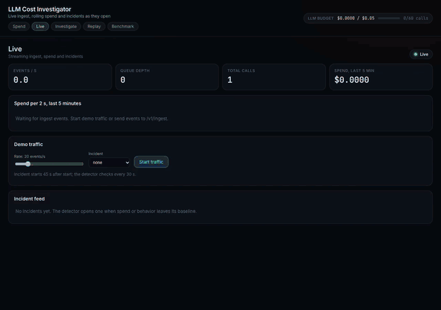

# Tier D: live end to end

A small app (`examples/live_app/`) made real LLM calls and reported each call
to the investigator through a 30-line wrapper. After a clean baseline, the app
switched on three real bugs, one at a time. The investigator ran as it would
in production: `POST /v1/ingest`, a detector tick every 30 s, and the Live tab.

Pre-registered rule ([PREREGISTRATION.md](../../benchmarks/PREREGISTRATION.md), Tier D):
each bug is labelled correctly within 2 windows of its start, with 0 alarms
during the baseline (at least 60 min). Scorer: `benchmarks/tier_d/score.py`.

## Result: pass, over two takes

| Bug | Take | Bug start (IST) | Incident created (IST) | Time to detect | Label and feature | Confidence |
|---|---|---|---|---|---|---|
| Uncapped retry loop (JSON validator that never passes, hard stop at 15) | 4 | 13:27:31 | 13:28:29 | 58 s | `uncapped_retry_loop` on classify | 0.82 |
| Switch to a pricier model (gpt-oss-20b to gpt-oss-120b) | 5 | 19:18:58 | 19:22:56 | 3 min 58 s | `expensive_model_misroute` on summarize | 0.70 |
| Self-calling agent that resends its full history (depth 8) | 5 | 19:48:58 | 19:49:57 | 59 s | `context_bloat_self_calling_agent` on reflect | 0.84 |

- Baseline alarms: **0** in take 4 (75 min) and **0** in take 5 (75 min).
- Wrong labels: **0**. Every incident in takes 4 and 5 has the right cause on the right feature.
- Each incident window starts at or just before the bug start, so all three meet the 2-window rule.
- Spend: take 4 $0.094, take 5 $0.206.

Video: [tier_d_take5_timelapse.mp4](media/tier_d_take5_timelapse.mp4) (54 s time-lapse of the 2 h 15 min take, one frame every 5 s).
The music is original, made by [make_music.py](media/make_music.py) (Python standard library only, no samples).

[](media/tier_d_take5_timelapse.mp4)
Screenshot: [tier_d_take5_live_tab.png](media/tier_d_take5_live_tab.png).
Scores: [tier_d_take4.json](data/tier_d_take4.json), [tier_d_take5.json](data/tier_d_take5.json). Raw logs: `data/tier_d_take{3,4,5}_raw/`.

## Caveats

- **Two takes, not one.** The network failed in take 4 from about 13:37 IST to the
  end: 705 of 1,220 calls failed on both providers. The misroute and bloat bugs ran
  with no successful calls, so take 4 did not test them. Take 5 re-ran those two
  bugs with a fresh baseline. See addendum 6.
- **Deterministic agents.** The live API diagnosed with the deterministic agents
  (no LLM). The LLM path is tested separately (Tier A ablation).
- **Not a customer app.** The bugs are real code faults in a demo app with real
  API calls. They are not incidents from a production system.
- The misroute took about 4 min to confirm. A new model needs a few calls before
  the unit-cost rule fires.

## Every take, published

| Take | Date | What happened |
|---|---|---|
| 1 | 2026-11-12 | 0 baseline alarms; retry loop caught in its first window. Misroute invalid (network outage). SSD unplugged before bloat. |
| 2 | 2026-11-12 | 69 min clean baseline, 0 alarms. SSD disconnected before any bug. |
| 3 | 2026-11-12 | Stopped at 52 min of baseline (0 alarms). Slow calls had put the app 26 min behind. Fixed in `b64d916`: hard 25 s limit per call, no SDK retries, slot clock. |
| 4 | 2026-11-13 | 0 baseline alarms; retry loop caught in 58 s. Network outage voided misroute and bloat. 0 false alarms during the 80-min outage. |
| 5 | 2026-11-13 | 0 baseline alarms; misroute caught in 3 min 58 s, bloat in 59 s. |

## Reproduce

```bash
PYTHONPATH=web:. LLMCI_TICK_S=30 .venv/bin/python -m uvicorn api.app:app --port 8000 &
DEPLOY_API_KEY=... PYTHONPATH=. .venv/bin/python examples/live_app/app.py \
    --bug misroute,bloat --rate 4 --baseline-minutes 75 --minutes 20 --gap-minutes 10 > app.log
curl -s localhost:8000/api/incidents/live > incidents.json
PYTHONPATH=. .venv/bin/python -m benchmarks.tier_d.score --app-log app.log --date YYYY-MM-DD \
    --incidents incidents.json --bugs misroute,bloat
```
